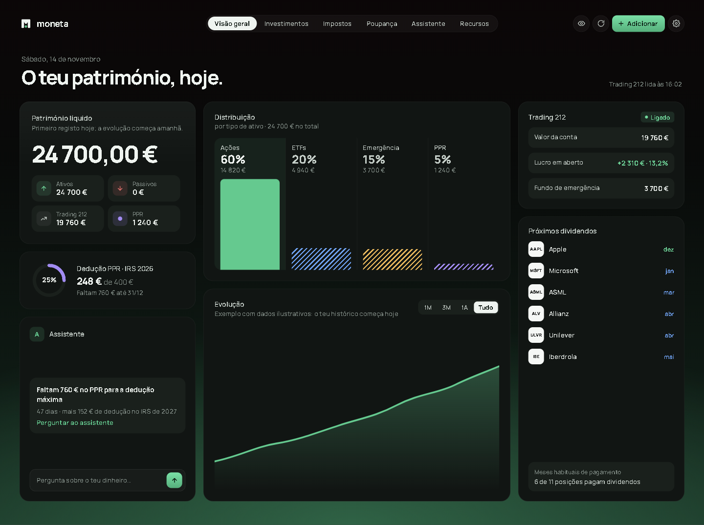
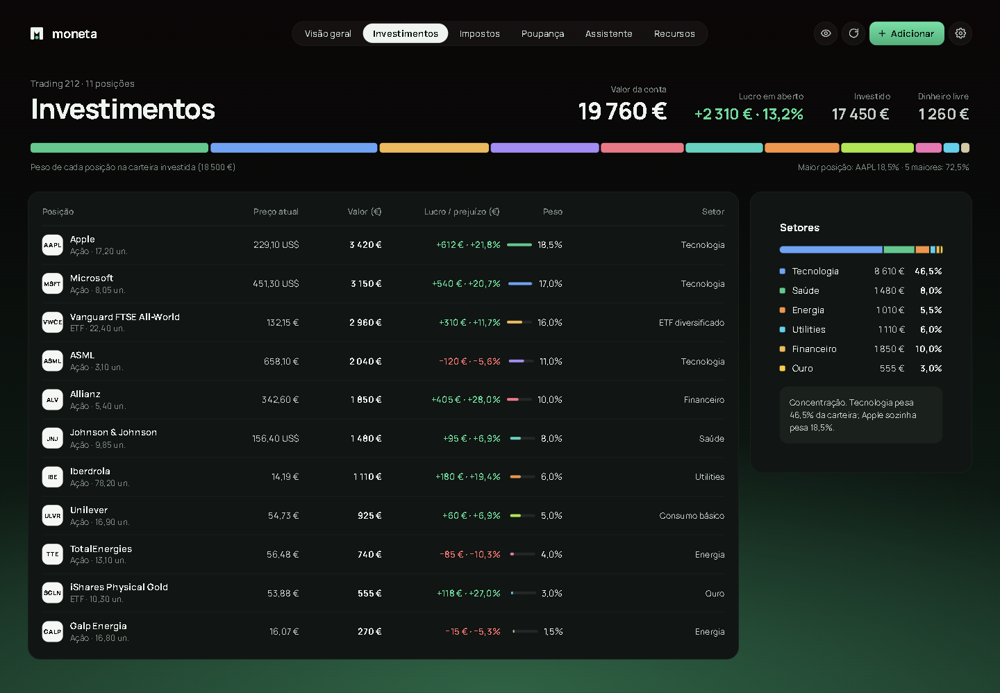
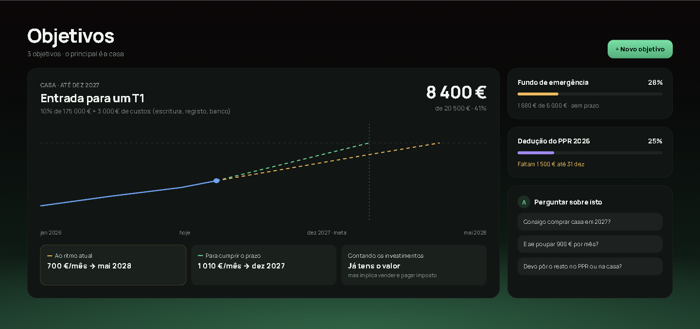

<h1 align="center">moneta</h1>

<p align="center">
  <b>Your whole net worth in one place. Running on your computer, not in someone's cloud.</b><br>
  Stocks, ETFs, savings, PPR, debts, taxes and goals, in a calm dark interface.
</p>

<p align="center">
  <a href="#quick-start">Quick start</a> ·
  <a href="#features">Features</a> ·
  <a href="#connections">Connections</a> ·
  <a href="#privacy">Privacy</a> ·
  <a href="#português">Português</a>
</p>

<p align="center">
  
</p>

---

## Why

Most net-worth apps want your bank login and keep your data on their servers. Moneta is the opposite: a small Node server that runs on `localhost`, stores everything in one JSON file on your machine, and talks only to the services you connect, with **read-only** keys.

It was built for an investor in Portugal (the interface is in European Portuguese, taxes follow Portuguese rules), but the core works for anyone.

## Features

| | |
|---|---|
| **Visão geral** | Net worth, distribution by category, evolution over time, interest and upcoming dividends. |
| **Investimentos** | A ledger of every position: weight, value, open profit, sector and type breakdown. |
| **Impostos** | An estimate of the capital gains and dividend tax to set aside, from your real Trading 212 history. |
| **Objetivos** | Savings goals with a projection: when you'll get there at your pace, and how much per month you'd need. |
| **Assistente** | Ask questions about your money, using Claude or Google Gemini with your own key. |
| **Recursos** | Short articles in plain language, such as how tax-loss harvesting works. |

<p align="center">
  
  
</p>

## Quick start

You need **[Node.js 20 or newer](https://nodejs.org)**.

```bash
git clone https://github.com/TiagoMoreira003/moneta.git
cd moneta
npm install
npm start
```

Open **http://localhost:3210**.

On Windows you can also double-click **`iniciar.bat`**: it starts the server and opens the browser.

### Options

| Variable | Default | What it does |
|---|---|---|
| `PORT` | `3210` | Port of the local server. |
| `MONETA_DATA` | see below | Folder where your data is stored. |

Default data folder:

- **Windows:** `%APPDATA%\Moneta`
- **macOS:** `~/Library/Application Support/Moneta`
- **Linux:** `~/.local/share/moneta`

The data lives outside the code folder on purpose, so updating or deleting the app never touches it, and it never ends up in git.

## Connections

Open **Definições → Ligações** and follow the three steps: choose, paste the key, test and save. Moneta only saves a key after a successful test.

| Service | What you need | Status |
|---|---|---|
| **Trading 212** | An API key with read-only permissions (Account data, Portfolio, Metadata, History). No trading permissions. | Positions, cash, history |
| **Interactive Brokers** | A Flex Web Service token and query ID. [How to create it](https://www.interactivebrokers.com/docs/web-api/flex-web-service/introduction) | Connection test (positions coming soon) |
| **Anthropic (Claude)** | An API key from console.anthropic.com | Assistant |
| **Google Gemini** | A free API key from aistudio.google.com. On the free tier Google may use the data to improve its products. | Assistant |

Everything else (savings, PPR, emergency fund, debts) you add by hand.

## Privacy

- The server listens only on `127.0.0.1` and rejects requests from other hosts.
- Your data is one file: `patrimonio.json` in the data folder. Back it up like any important file.
- **API keys are stored in plain text in that file.** Keep the folder private and don't sync it to a shared cloud drive.
- Network requests leave your machine only to: the brokers you connect, the assistant provider you choose (only when you ask a question, with a summary of your finances), exchange rates, and Google Fonts / jsDelivr for the font and charts.

## Project structure

```
moneta/
├── server.js          # local HTTP server, API, broker connectors, assistant
├── public/index.html  # the whole interface (vanilla HTML, CSS and JS)
├── iniciar.bat        # Windows launcher
├── rule.md            # color system (black to green)
└── DESIGN.md          # design direction and decisions
```

No framework, no build step. Edit a file and restart the server.

## Disclaimer

Moneta is a personal tool, not financial or tax advice. Tax figures are estimates; confirm them with the Autoridade Tributária or an accountant before filing.

## License

[GNU AGPL v3](LICENSE). You can use, study, change and share Moneta freely. If you distribute a modified version, or run one as a service for other people, you must publish your source code under the same license.

---

## Português

**Moneta** junta o teu património num só sítio: ações, ETFs, poupanças, PPR, dívidas, impostos e objetivos. Corre no teu computador e os dados ficam num ficheiro teu.

**Para correr:** instala o [Node.js 20+](https://nodejs.org), depois

```bash
npm install
npm start
```

e abre **http://localhost:3210** (no Windows basta abrir o `iniciar.bat`).

**Ligações:** em Definições → Ligações, cria uma chave da Trading 212 só de leitura, cola, testa e guarda. Para o assistente podes usar uma chave da Anthropic ou uma chave gratuita do Google Gemini.

**Os teus dados** ficam em `%APPDATA%\Moneta` (Windows). As chaves estão em texto simples nesse ficheiro: não sincronizes essa pasta com a nuvem.

Os valores de impostos são estimativas informativas, não aconselhamento fiscal.
